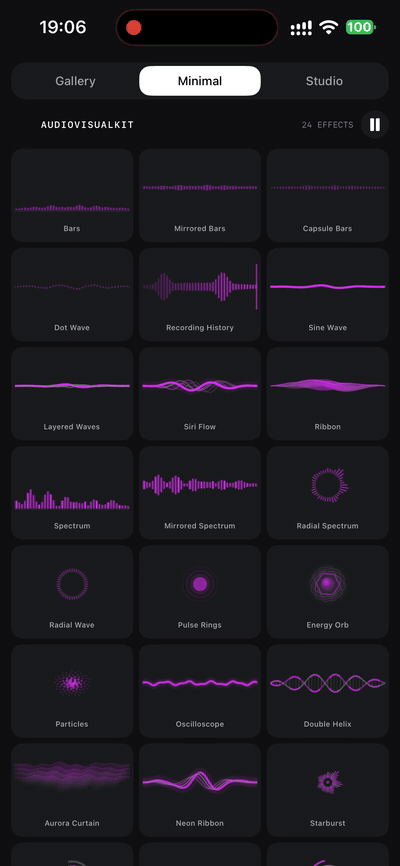
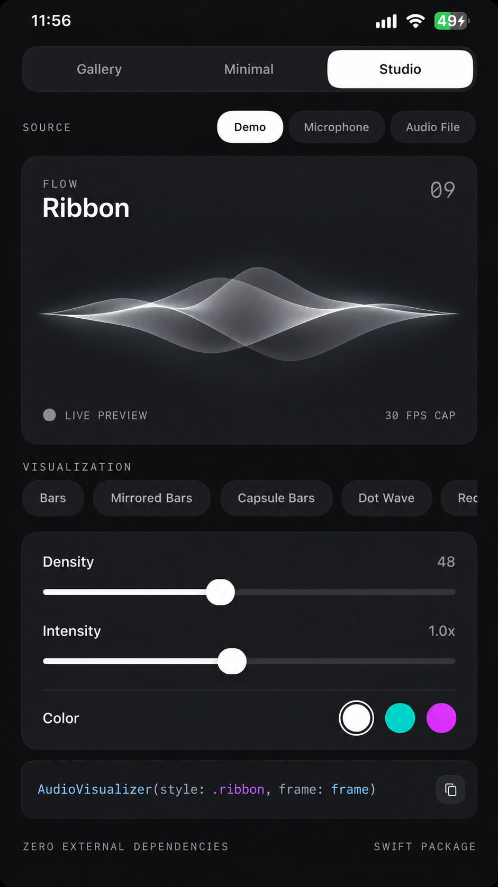

<div align="center">


# AudioVisualKit

[](LICENSE)
[](https://swift.org)
[](https://developer.apple.com)


**24 audio-reactive SwiftUI visualizations. One Swift Package. No external dependencies.**

A reusable audio visualization toolkit for voice interfaces, recorders, music players, and interactive experiences.

[中文说明](README.zh-CN.md) · [Getting Started](#getting-started) · [Effects](#effects) · [Demo](#run-the-demo) · [Contributing](CONTRIBUTING.md)


*Brand artwork (not a screenshot of the running application).*



*Real device recording. Watch the full demo video [here](Docs/demo.mp4).*

</div>

> **V3 status:** The updated source passes syntax checks and Foundation-model type-checking. The V3 package and Demo have **not** yet been rebuilt in Xcode or validated on an iOS device. See [QA REPORT](Docs/QA_REPORT.md).

## Features

- **24 effects:** waveforms, fluid ribbons, music spectrum, generative ambient visuals.
- **Data-driven:** feed normalized `AudioFrame` data from any engine, recorder, or stream.
- **SwiftUI:** transparent `Canvas` views with configurable color and density.
- **Demo modes:** Gallery, Studio, and a dense Minimal view for recording preview GIFs.
- **Input adapters:** synthetic demonstration signal, an opt-in iOS microphone controller, offline playback-aligned FFT / PCM / envelope extraction.
- **Zero external packages:** uses SwiftUI, Foundation, AVFoundation, and Accelerate from Apple SDKs.
- **Supported deployment targets:** iOS 17+ and macOS 14+ for the visualization library. The bundled microphone controller is iOS-only.

## Effects

| Family | Visualizations |
| --- | --- |
| Waveforms (6) | Bars, Mirrored Bars, Capsule Bars, Dot Wave, Recording History, Oscilloscope |
| Flow (7) | Sine Wave, Layered Waves, Siri Flow, Ribbon, Double Helix, Aurora Curtain, Neon Ribbon |
| Spectrum (4) | Spectrum, Mirrored Spectrum, Radial Spectrum, Starburst |
| Ambient (7) | Radial Wave, Pulse Rings, Energy Orb, Particles, Orbiting Arcs, Lotus, Vortex |

All 24 styles are first-class API cases. Original style identifiers are unchanged for source compatibility.

## Getting started

### Swift Package Manager

In Xcode use **File → Add Package Dependencies** and enter:

```
https://github.com/YOUR_ACCOUNT/AudioVisualKit.git
```

Or add it to your own `Package.swift`:

```swift
dependencies: [
    .package(url: "https://github.com/YOUR_ACCOUNT/AudioVisualKit.git", from: "1.0.0")
]
```

Then `import AudioVisualKit`. For local development, add this package with **Add Local…** from Xcode — the included Demo already references the package locally, so no network access is required to build it.

### One visualizer

```swift
import AudioVisualKit
import SwiftUI

struct Example: View {
    var body: some View {
        TimelineView(.animation(minimumInterval: 1.0 / 30)) { clock in
            let audio = DemoAudioSignal.frame(at: clock.date.timeIntervalSinceReferenceDate)
            AudioVisualizer(style: .neonRibbon,
                            frame: audio,
                            color: .white,
                            secondaryColor: .gray,
                            density: 48)
                .frame(height: 140)
        }
    }
}
```

The library view **does not** capture audio or start its own display clock. Multiple views should share their parent timeline, as demonstrated by the Minimal gallery.

### Real-time input

On iOS the optional sample adapter supports live microphone input:

```swift
@StateObject private var microphone = AudioCaptureController()

var body: some View {
    AudioVisualizer(style: .starburst, frame: microphone.frame)
        .task { try? await microphone.start() }
        .onDisappear { microphone.stop() }
}
```

Set `NSMicrophoneUsageDescription` in your app's Info.plist. For an existing recorder, **do not create a second audio engine**: analyze its buffers and provide an `AudioFrame` directly. See [integration recipes](Docs/RECIPES.md).

### From an audio file

```swift
let levels = try AudioFileWaveform.amplitudes(url: localURL, sampleCount: 180)
let visualFrame = AudioFrame(amplitude: 0, levels: levels)
```

For playback-aligned FFT and signed PCM, use the V3 analyzer instead (perform it off the main actor):

```swift
let data = try AudioFileWaveform.analyze(url: localURL)
let current = data.frame(at: player.currentTime)
AudioVisualizer(style: .radialSpectrum, frame: current)
```

`amplitudes` still returns *only* a static amplitude envelope. The new `analyze` API returns bounded timestamped real FFT and PCM snapshots.

## Run the demo

1. Open `Demo/AudioVisualKitDemo.xcodeproj` in Xcode.
2. Choose a simulator or iPhone and select your own development team if signing is required.
3. Select **Gallery** to browse grouped cards, **Minimal** for the full 24-style animation wall, or **Studio** to tune a chosen effect.
4. Demo signal runs without microphone permission. Microphone mode needs a compatible device and permission. Audio File imports a user-selected local audio file.



*Studio design concept. The real interface is rendered by SwiftUI; its appearance may differ.*

To create a GIF from a **real** simulator/device screen recording:

```bash
brew install ffmpeg
bash Scripts/make-gif.sh /path/to/Minimal.mov
```

The script writes `Docs/Assets/minimal-preview.gif` by default; pass a second argument to change the output path. It picks a narrower output for portrait phone captures automatically. The committed `Docs/Assets/demo.gif` was produced with this script from a real device recording (full video: [Docs/demo.mp4](Docs/demo.mp4)); record a fresh GIF the same way whenever the interface changes. Do not present the designed concept image as evidence of tested runtime rendering.

## API overview

| API | Purpose |
| --- | --- |
| `AudioFrame(amplitude:peak:levels:spectrum:timestamp:history:samples:)` | Envelope/history/FFT clamped 0–1, PCM clamped -1…1 |
| `AudioVisualizationStyle.allCases` | All 24 styles; `title` and `group` metadata |
| `AudioVisualizer(style:frame:color:secondaryColor:density:)` | Stateless SwiftUI renderer |
| `DemoAudioSignal.frame(at:count:)` | Deterministic preview data |
| `AudioCaptureController` | Optional iOS AVAudioEngine input adapter |
| `AudioFileWaveform.amplitudes(url:sampleCount:)` | Offline waveform-envelope extraction |
| `AudioFileWaveform.analyze(url:)` | Background-callable, bounded real FFT and bipolar PCM timeline |
| `AudioFileAnalysis.frame(at:)` | Select nearest analyzed frame for playback time |

## Architecture & validation

[Design and constraints](Docs/DESIGN.md) · [Recipes](Docs/RECIPES.md) · [Test checklist](Docs/TESTING.md) · [Changelog](CHANGELOG.md)

- The presentation layer runs in SwiftUI `Canvas` and does not own timers or audio sessions.
- Demo visuals use a deterministic synthetic signal; audio-reactive does **not** imply microphone access.
- The sample microphone FFT and its allocations must be profiled using Instruments before production use.
- `30 FPS TARGET` is a scheduling target, not a measured performance guarantee.
- **V3 validation:** Swift syntax and pure-model type-checking completed; this revised V3 has not been built with Xcode or tested on real hardware. Previous V2 build results do not validate the revised sources. See [TESTING](Docs/TESTING.md) and [QA REPORT](Docs/QA_REPORT.md).

## Contributing and security

Pull requests welcome. Please read [CONTRIBUTING.md](CONTRIBUTING.md), [CODE_OF_CONDUCT.md](CODE_OF_CONDUCT.md), and [SECURITY.md](SECURITY.md).

To validate the package locally on macOS using Xcode command-line tools:

```bash
swift build
swift test
```

## License

[MIT](LICENSE). Art and icons bundled in this repository may be redistributed under the same license by this project's contributors; please confirm provenance/rights before replacing them with third-party assets.

## V3 accuracy and data sources

The 24 visualizations are driven by four independent data channels: `levels` (amplitude envelope), `history` (oldest → newest), `spectrum` (real FFT bands), and `samples` (signed PCM). Use `AudioFrame(...)` to bridge an existing recording engine. For file playback:

```swift
// Perform file analysis on a background task, not on the main actor.
let analysis = try AudioFileWaveform.analyze(url: fileURL)
let current = analysis.frame(at: playbackTime)
AudioVisualizer(style: .radialSpectrum, frame: current)
```

Replace `YOUR_ACCOUNT` with your actual GitHub username before publishing. There are no GitHub Actions workflows in this repository.

The Demo's Minimal grid deliberately uses complete synthetic Demo data even if Studio previously selected a microphone or a file. Entering Minimal stops live audio capture to avoid hidden microphone use. Source-compatible `AudioFrame` initialization is preserved; optional `history` and `samples` have default `[]` values.

**Publication status:** V3 code audit and parser checks finished. iOS SDK build, simulator rendering, real-time audio and long-file acceptance still require Xcode / a physical device; do not represent them as verified.
