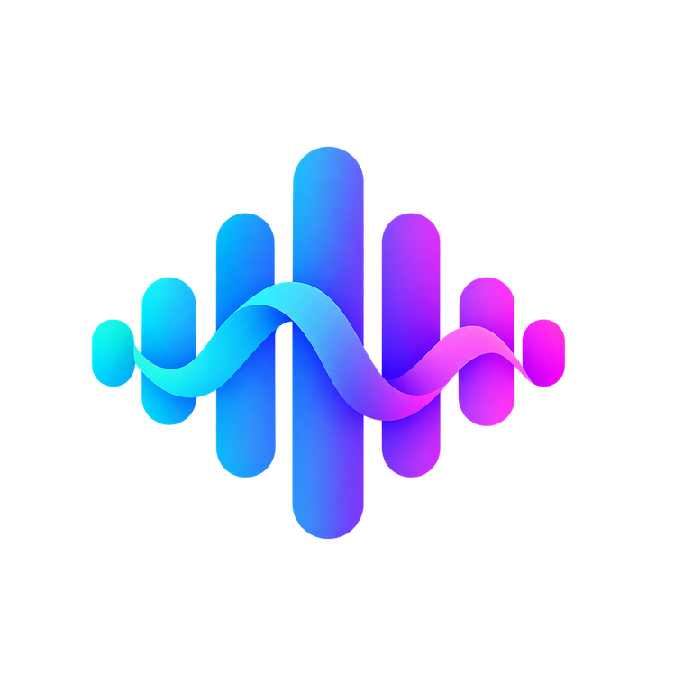
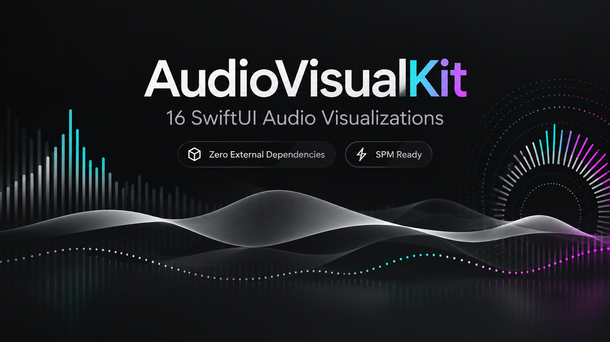

<div align="center">


# AudioVisualKit

**24 种 SwiftUI 声音可视化效果。原生 SPM，零第三方依赖。**

[English README](README.md) · [开发约定](CONTRIBUTING.md) · [测试清单](Docs/TESTING.md)



*上图为品牌宣传素材，并非应用实际运行截图。*
</div>

> **状态声明：** 当前版本已完成源代码改动、语法解析及工程结构检查，尚未完成 iOS SDK 编译与真机性能测试，因此不能直接视为生产级稳定版本。

## 包含内容

- 原始 16 种 + 新增 8 种视觉效果，共 **24 种**。
- **Gallery**：分类浏览并选择效果。
- **Minimal**：3/4 列高密度动画矩阵，便于录制 GitHub GIF。
- **Studio**：大预览、样式选择、密度、强度、颜色及代码复制。
- **Demo / Microphone / Audio File**：模拟数据、实时麦克风和本地文件波形。
- **SwiftUI Canvas**：所有组件背景透明，业务工程提供 `AudioFrame`，组件不自动启动计时器或录音。

## 新增 8 种效果

| 分类 | 新增效果 | 特点 |
| --- | --- | --- |
| Waveforms | Oscilloscope | 随声音起伏的示波器曲线 |
| Flow | Double Helix | 双股螺旋曲线与连接线 |
| Flow | Aurora Curtain | 多层透明极光幕布 |
| Flow | Neon Ribbon | 多层高亮流动细线 |
| Spectrum | Starburst | 放射状频段尖芒 |
| Ambient | Orbiting Arcs | 多圈反向轨道与动态端点 |
| Ambient | Lotus | 随音量变化的十瓣花 |
| Ambient | Vortex | 三股旋转涡线 |

## 使用

在 Xcode 中打开 `Demo/AudioVisualKitDemo.xcodeproj`。工程通过 **本地 Swift Package** 引用根目录 `Package.swift`。如需发布到 GitHub，将仓库真实地址通过 Xcode 的 Add Package Dependencies 添加到其他项目即可。

```swift
import AudioVisualKit

AudioVisualizer(
    style: .auroraCurtain,
    frame: audioFrame,
    color: .white,
    secondaryColor: .gray,
    density: 48
)
.frame(height: 120)
```

应用需要自备 `audioFrame`；演示阶段可通过 `DemoAudioSignal.frame(at:)` 生成模拟数据。请在上层视图使用统一的 `TimelineView` 驱动所有动画。

录音需要 `NSMicrophoneUsageDescription`。如果已有录音引擎，建议**复用现有 `AVAudioEngine` 并转换成 `AudioFrame`**，不要启动第二套录音会话。

本地音频文件目前只提取振幅包络，不会自动生成实时 FFT 频谱。见 [使用示例](Docs/RECIPES.md) 和 [测试清单](Docs/TESTING.md)。

## 开源发布检查

- [ ] Xcode iOS 模拟器 Debug/Release 编译
- [ ] iPhone 真机麦克风授权、开始、停止、切后台、恢复
- [ ] 24 种动画视觉和缩放验收
- [ ] Minimal 多组件帧率、能耗和内存测试
- [ ] 真机或模拟器录制 GIF，并替换 README 中的概念图
- [ ] 填写真实 GitHub 仓库链接、发布版本与 Release Notes

其他材料：`LICENSE`、`CONTRIBUTING.md`、`CODE_OF_CONDUCT.md`、`SECURITY.md`、`CHANGELOG.md`。**没有创建 GitHub Actions。**
